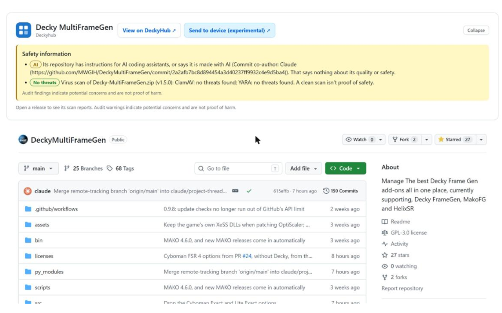
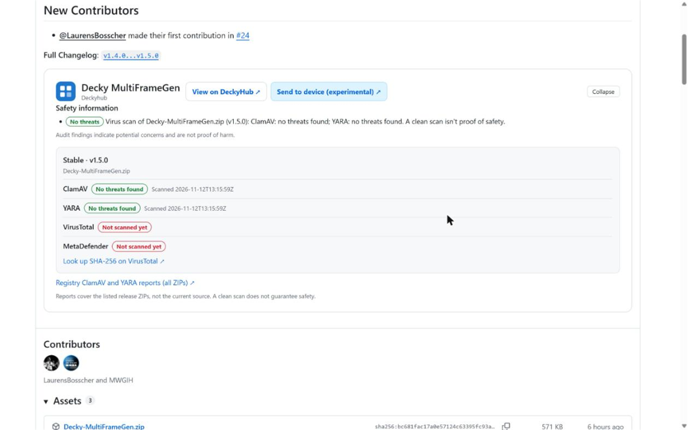

<div align="center">


# Deckyhub for GitHub

**See what [DeckyHub](https://deckyhub.com) knows about a Decky plugin, right on its GitHub page.**

[](https://github.com/mazillka/deckyhub-ext/releases/latest)
[](https://github.com/mazillka/deckyhub-ext/actions/workflows/build-prod.yml)
[](LICENSE.md)
[](https://ko-fi.com/mazillka)

[**Chrome Web Store**](https://chromewebstore.google.com/detail/aiibhedbgiineocopdokapoaedeedhkc) · [**Firefox Add-ons**](https://addons.mozilla.org/en-US/firefox/addon/deckyhub/) · [Releases](https://github.com/mazillka/deckyhub-ext/releases) · [Privacy](#privacy) · [Report an issue](https://github.com/mazillka/deckyhub-ext/issues)

</div>

A browser extension for Chrome, Edge, Opera, Brave, Vivaldi and Firefox, for anyone who reads a plugin's GitHub page before installing it. When you open a repository that DeckyHub lists as a [Decky Loader](https://decky.xyz/) plugin, it adds what the registry knows about its safety to the page. It gives you the facts, including what is missing. It doesn't score plugins: whether to install is up to you.

Safari isn't supported yet: it needs the extension wrapped in an Xcode app, which hasn't been built or tested.

## What you see

| Page | What the extension adds |
| --- | --- |
| **Repository** | A panel with the plugin's name and safety badges: virus-scan result, audit warnings, runs as root, fork, in the Decky store, written in Rust, made with AI. It also links to the author's other plugins on DeckyHub. |
| **Releases list** and **single release** | A block under each release: its virus-scan badge, audit warnings, root and pre-release badges, and its scan reports from ClamAV, YARA, VirusTotal and MetaDefender, with a VirusTotal lookup by file hash. |
| **A repository DeckyHub doesn't list** | If it has a `plugin.json` at the root (so it looks like a Decky plugin), a panel says DeckyHub has no audit findings or virus scans for it, with a **Suggest it for DeckyHub** link. The link opens the registry's "Add a plugin" form with the repository filled in; you read it and submit it yourself. |

Panels for listed plugins also link to the plugin's DeckyHub page, **Send to device (experimental)** and **Search YouTube** (a search for the plugin's name plus "Decky"; what it finds isn't checked). Links on a release open that exact version on DeckyHub.

- **Scan badge:** **Nothing flagged** only when all four scanners have reported and none flagged the file. With fewer reports it reads **Not fully scanned** with the count, such as 2/4. **Threat found** means a scanner flagged it.
- **Collapse:** every panel has a Collapse / Expand button, and the toolbar popup has a setting to start panels collapsed.
- **Older releases:** the registry keeps reports for the newest releases of each plugin (three stable and three pre-releases). Others show that there is no scan report.

## Screenshots

> These were taken with an earlier version. Badge wording has changed since (a result from two of four scanners now reads **Not fully scanned · 2/4**), and panels have more links.





## Install

### From your browser's store

| Browser | Get it from |
| --- | --- |
| Chrome, Brave, Vivaldi | [Chrome Web Store](https://chromewebstore.google.com/detail/aiibhedbgiineocopdokapoaedeedhkc) |
| Opera | The Chrome Web Store link, with Opera's "Install Chrome Extensions" add-on |
| Firefox | [Firefox Add-ons](https://addons.mozilla.org/en-US/firefox/addon/deckyhub/) |
| Edge | [Microsoft Edge Add-ons](https://microsoftedge.microsoft.com/addons/detail/0RDCKCC67NNF) (the link works once Microsoft approves the listing; until then, use a release package) |

A store can be a version behind the newest [release](https://github.com/mazillka/deckyhub-ext/releases) while it reviews an update.

### From a release

Each [release](https://github.com/mazillka/deckyhub-ext/releases) has two packages and their checksums (`SHA256SUMS.txt`):

- **Chrome, Edge, Opera, Brave, Vivaldi:** download `deckyhub-security-chromium-vX.Y.Z.zip` and unzip it. Open the browser's extensions page (for example `chrome://extensions`), turn on **Developer mode**, choose **Load unpacked** and pick the unzipped folder.
- **Firefox 127 or newer:** download `deckyhub-security-firefox-vX.Y.Z.zip`. Open `about:debugging#/runtime/this-firefox`, choose **Load Temporary Add-on** and pick the ZIP. Firefox removes a temporary add-on when it closes.

Then try it on a listed plugin, for example [MWGIH/DeckyMultiFrameGen](https://github.com/MWGIH/DeckyMultiFrameGen/releases). Reload the GitHub page after installing or updating.

## What the results mean

- A report describes the release ZIP named in the panel, not other releases and not the repository's current source.
- **A clean scan doesn't prove a plugin is safe**, and an incomplete scan doesn't establish safety. A missing warning doesn't mean an audit was done.
- Code in a download that isn't in the source is **very high risk**, because the release may not match the repository. An automated mismatch is still not proof of malware: review the release and source before installing.
- For plugins distributed only through the Decky Store, the extension sends you to the store and doesn't present reports from old GitHub releases as results for the store version.
- Data can be late, missing or stale, and a new release may not have reports yet.

## Privacy

The extension downloads the public registry files from `raw.githubusercontent.com`: the plugin list, audit stats, virus-scan summaries, and VirusTotal and MetaDefender reports. It keeps them in extension storage for 30 minutes and uses the last copy if a refresh fails.

- It doesn't send your browsing history anywhere or make a request per repository.
- It never uploads files or runs scans.
- GitHub, which also hosts the data, sees normal network request information.
- Links to VirusTotal, MetaDefender, DeckyHub, YouTube and the registry's "Add a plugin" form open only when you click them. The form link carries only the repository's name, and nothing is submitted until you do.
- The only setting it saves is "collapse panels by default".

Its only permissions are `storage`, access to the registry's files on `raw.githubusercontent.com`, and running on `github.com` pages.

## Development

You need Node.js 22 and npm. CI uses the same version.

```bash
cd extension
npm ci
npm run build-all
```

`build-all` type-checks, runs the tests, and builds `dist/` (Chromium) and `dist-firefox/` (Firefox) with a ZIP of each. Load `extension/dist`, or `extension/dist-firefox/manifest.json` in Firefox, as described under [From a release](#from-a-release).

| Command | What it does |
| --- | --- |
| `npm run typecheck` | `tsc --noEmit` |
| `npm test` | Node's test runner on `extension/test/` (jsdom for the content script, no browser needed) |
| `npm run build-dev` | A Chromium development build |
| `npm run build-prod` / `npm run build-firefox` | One production build |

The tests don't cover the real GitHub pages, so check changes to what appears there in a browser.

| Where | What |
| --- | --- |
| `extension/src/background.ts` | Fetches, validates and caches registry data |
| `extension/src/contentscript.ts`, `extension/src/content/` | Follows GitHub's navigation and draws the panels, badges and scan reports |
| `extension/src/popup.ts` | The toolbar popup and its setting |
| `store/` | Store listing text and images |

Read [AGENTS.md](AGENTS.md) and the [skills](SKILLS.md) before changing anything. Warning texts come from the registry's [`warnings.json`](https://github.com/mazillka/deckyhub-registry/blob/main/registry/warnings.json): change them there first. A change to what users are told also belongs in the plugin, the website and the registry.

A tag `vX.Y.Z` on `main` builds a release, and [`stores.yml`](.github/workflows/stores.yml) then uploads it to the stores that have secrets set (its header lists them).

## Related projects

- [deckyhub-plugin](https://github.com/mazillka/deckyhub-plugin): DeckyHub itself, the plugin that finds, installs and updates Decky plugins in Gaming Mode
- [deckyhub-registry](https://github.com/mazillka/deckyhub-registry): the plugin list, audit data and virus scans this extension shows
- [deckyhub-site](https://github.com/mazillka/deckyhub-site): the website, [deckyhub.com](https://deckyhub.com/)
- [deckyhub](https://github.com/mazillka/deckyhub): all the DeckyHub repositories in one clone

## License

Copyright © 2026 Andrii Shevchuk-Yuhanets ([mazillka](https://github.com/mazillka)).

GPL-3.0-or-later: see [LICENSE.md](LICENSE.md).

Not affiliated with GitHub, Valve or the Decky Loader project.
