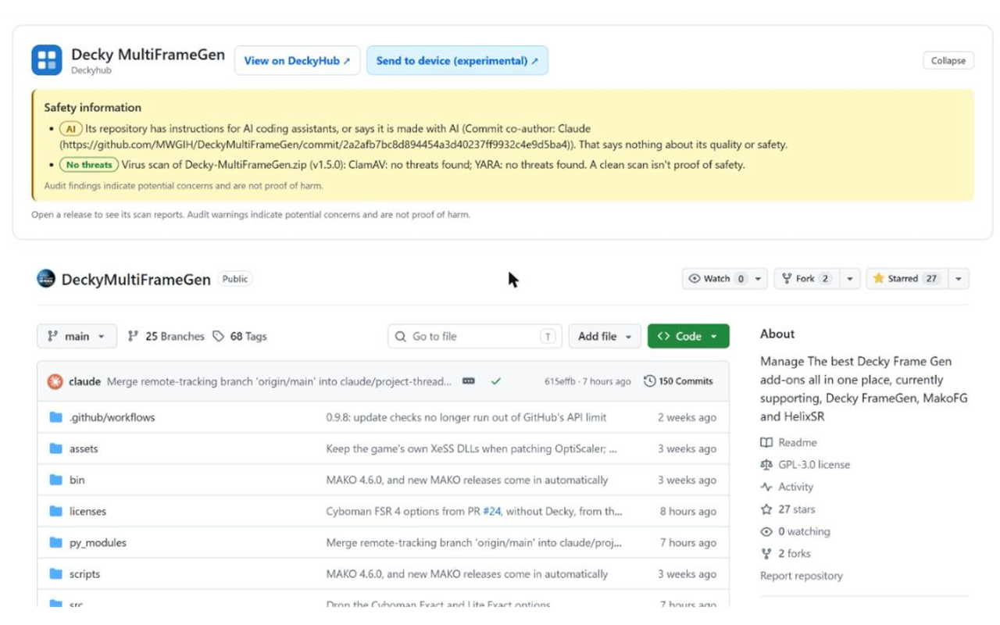
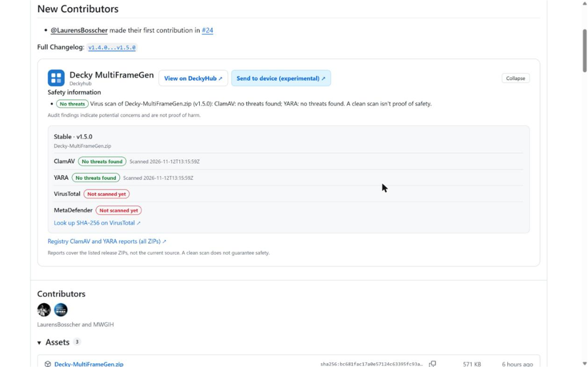
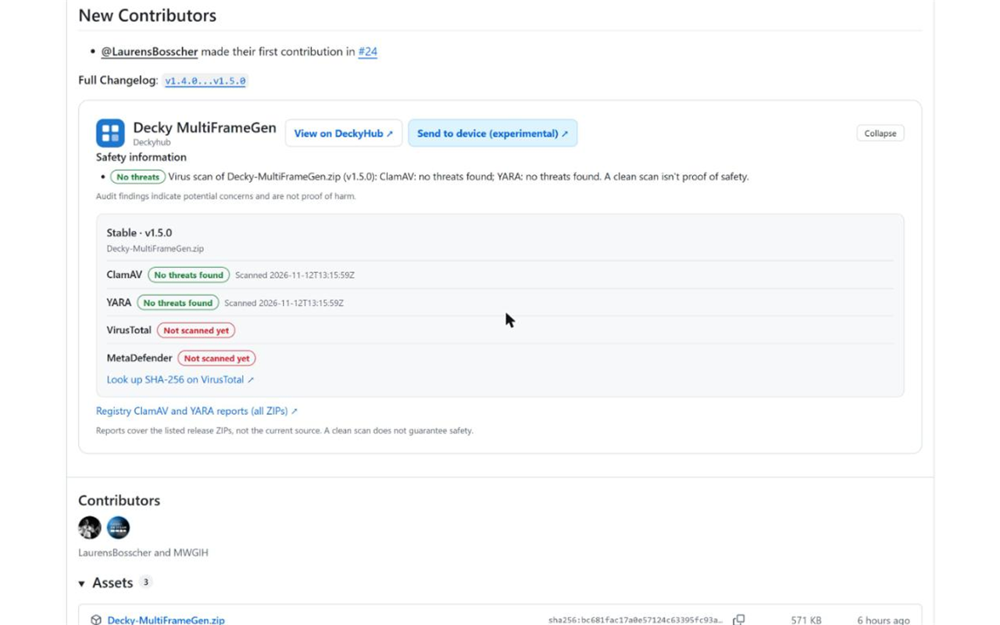

# Deckyhub for GitHub

[](https://ko-fi.com/mazillka)

A browser extension for Chrome, Edge, Opera, Brave, Vivaldi and Firefox. When you open a GitHub repository that [DeckyHub](https://deckyhub.com) lists as a Decky plugin, it shows what the registry knows about its safety, right on the page.

## What you see

- **On the repository page:** a short panel with the plugin's name, links to its DeckyHub page and **Send to device (experimental)**, and safety badges: runs as root, audit warnings, fork, in the Decky store, made with AI, and the latest virus-scan result.
- **On the Releases page:** a block under each release with the same links and badges for that release, plus its scan reports: ClamAV, YARA, VirusTotal and MetaDefender, and a VirusTotal lookup by file hash. The links open that exact version on DeckyHub.
- **On a single release page:** the same block as in the list.
- **Collapse:** every panel has a Collapse / Expand button. The extension's toolbar popup has a setting to start them collapsed.

The registry keeps scans for the three newest stable and three newest pre-releases of each plugin. Older releases show "No scan report for this release."

## Screenshots







## Install

### From your browser's store

- **[Chrome Web Store](https://chromewebstore.google.com/detail/aiibhedbgiineocopdokapoaedeedhkc)**: Chrome, and also Brave, Vivaldi and Opera (Opera can install from the Chrome Web Store with its "Install Chrome Extensions" add-on)
- **[Microsoft Edge Add-ons](https://microsoftedge.microsoft.com/addons/detail/0RDCKCC67NNF)**: Edge
- **[Firefox Add-ons](https://addons.mozilla.org/en-US/firefox/addon/deckyhub/)**: Firefox

The store listings are new and still in review: a link opens the extension's page once that store has approved it. Until then, use the packages below.

### From a release (easiest)

Each [release](https://github.com/mazillka/deckyhub-ext/releases) has both packages: `deckyhub-security-chromium-vX.Y.Z.zip` for Chrome, Edge, Opera, Brave and Vivaldi, and `deckyhub-security-firefox-vX.Y.Z.zip` for Firefox.

- **Chromium browsers:** unzip it, open the browser's extensions page (for example `chrome://extensions`), turn on **Developer mode**, choose **Load unpacked** and pick the unzipped folder.
- **Firefox (127 or newer):** open `about:debugging#/runtime/this-firefox`, choose **Load Temporary Add-on** and pick the ZIP. Firefox removes a temporary add-on when it closes.

### Build it yourself

You need Node.js 22 and npm.

```bash
cd extension
npm ci
npm run build-all     # type-checks, then builds dist/ (Chromium) and dist-firefox/ (Firefox)
```

Load `extension/dist` (or `extension/dist-firefox/manifest.json` in Firefox) as above. Reload the GitHub page after updating the extension.

Try it on a listed plugin, for example [MWGIH/DeckyMultiFrameGen](https://github.com/MWGIH/DeckyMultiFrameGen/releases).

## Privacy

The extension downloads the public registry files from `raw.githubusercontent.com`: the plugin list, audit stats, virus-scan summaries, and VirusTotal and MetaDefender reports. It keeps them in extension storage for 30 minutes and uses the last copy if a refresh fails. It does not send your browsing history anywhere or make a request per repository. GitHub and the data host see normal network request information. Links to VirusTotal, MetaDefender and DeckyHub open only when you click them; the extension never uploads files or runs scans. The only thing it saves is the "collapse by default" setting.

## What the results mean

Results describe the release ZIP named in the panel, not the plugin's source code or other releases. A missing warning does not mean an audit was done, and a clean scan does not prove a plugin is safe. Data can be late, missing or stale, and a new release may not have reports yet.

Store versions are published from each release by `.github/workflows/stores.yml`; see its header for the secrets it needs.

## For contributors

TypeScript, built with webpack. The source is in `extension/src/`: `background.ts` (fetches and caches registry data), `contentscript.ts` (draws the panels on GitHub), `popup.ts` (the setting), `types.ts` (data shapes). Read [AGENTS.md](AGENTS.md) and the skills in [SKILLS.md](SKILLS.md) before changing anything. There are no automated tests; `npm run typecheck` and a manual check in a browser are the gate.

## License

Copyright © 2026 Andrii Shevchuk-Yuhanets ([mazillka](https://github.com/mazillka)).

GPL-3.0-or-later: see [LICENSE.md](LICENSE.md).
